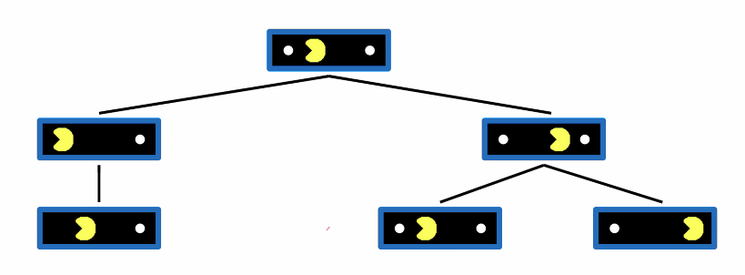
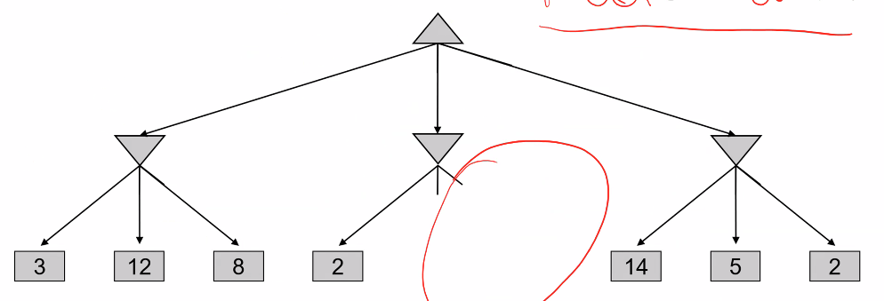
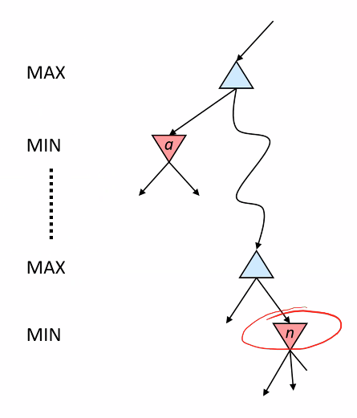
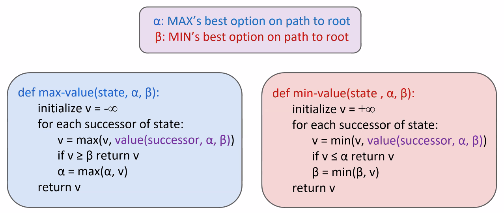

# Lecture #13 Notes - Adversarial Search
- Author: Evan Brooks
- Date: Wednesday, October 26th, 2026

## Evaluation Functions
- Evaluation functions score non-terminals in depth-limited search
- Ideal function: returns the actual minimax value of the position
  $Eval(s) = w_1f_1(s) + w_2f_2(s) + ... + w_nf_n(s)$
- e.g. $f_1(s) = (\text{num white queens} - \text{num black queens})$, etc.

## Thrashing: why Pacman starves

- A danger of replanning agents!
  - He knows his score will go up by eating the dot now and then doing something (west, east)
  - He knows his score will go up just as much by eatin the dot later (east, east)
  - There are no point-scoring opportunities after eating the dot (within the horizon, two here)
  - Therefore, waiting seems just as good as eating: he may go east, and then back west in the next round of replanning (as he will repeat that reasoning from somewhat analagous state with the depth of two)

## Game tree pruning

## Minimax example

- Skip evaluating a subtree the moment we prove it is worse than a path we already discovered. To do this, we track two variables during our depth-first search:
  - α (Alpha): The highest (best) score MAX is already guaranteed to get. (Starts at -∞)
  - β (Beta): The lowest (worst) score MIN is already guaranteed to hold MAX to. (Starts at +∞)
- We prune (stop looking at a node's siblings) the exact moment α ≥ β.

## Alph-Beta Pruning

- General configuration (MIN) version
  - We're computing the MIN-VALUE at some node $n$
  - We're looping over $n$'s children
  - $n$'s estimate of the children's min is dropping
  - Who cares about $n$'s value? MAX
  - Let $a$ be the best value that MAXZ can get at any choice point along the current path from the root
  - If $n$ becomes worse than $a$, MAX will avoid it, so we can stop considering $n$'s other children (it's already bad enough that it won't be played)
 - MAX version is symmetric

 ### Alpha-Beta pruning properties
 - Has no effect on minimax value computed for the root
 - Values of intermediate nodes might be wrong
  - Children of the root may ahjve the wrong value
  - So the most naive version won't let you do action selection
- Good child ordering improves effectiveness of pruning
- With "perfect ordering":
  - Time complexity drops to $O(b^{m/2})$ (otherwise $O(b^m)$)

## _Minimax_ properties
- Optimal against a perfect player. Otherwise?
- We can move towards _Expectimax_
  - "If we played 100 games, what set of actions would maximize my outcome"

## What did we learn today?
- Evaluation of Pacman w.r.t. re-planning
- Planning depth matters: deeper planning vs. better evaluation function
- Pruning algorithm: meta-reasoning for evaluating/pruning search paths
- From advsersarial to random-nature agents: how does that impact our decisions
- For some games, say tic-tac-toe, finding optimal policy in case of two adversarial agents results in coming to a draw at all times
- Depth-limited search: when depth-limited, optimality is NOT guaranted because we are evaluating in-progress states (non-terminal states)
- We apply the evaluation function in place of computing precisely minmax value remoes guarantee of optimality