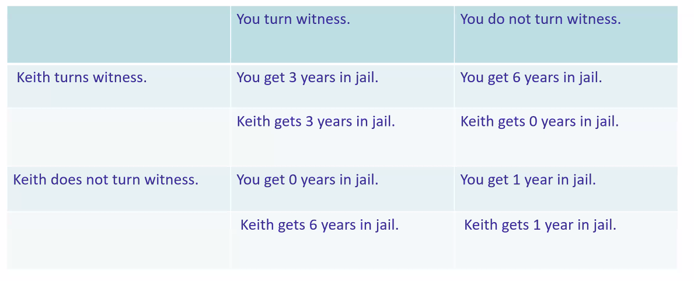
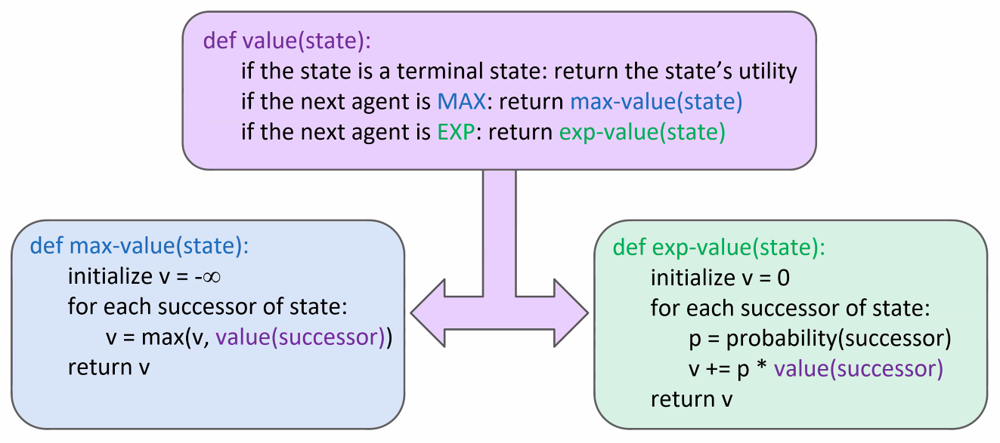

# Lecture #14 Notes - Expectimax
- Author: Evan Brooks
- Date: Wednesday, October 28th, 2026

## Worst-Case vs. Average Case - Expectimax
Idea: Uncertain outcomes controlled by chance, not by a perfect adversary. We can model this by replacing the MIN nodes in a minimax tree with chance nodes, which compute the expected value of their children.

## What if nondeterminism is on our way?
- Why wouldn't we know what the result of an action will be?
  - Explicit randomness: rolling dice
  - Unpredictable opponents: ghosts responding randomly
  - Actions can fail: when moving a robot, wheels might slip
- Outline:
  - Probabilities review: a tool to speak about randomness
  - Decision theory basics:
    - Tool that underlines the expectimax algorithm chance node
    - Notions of utility and expected utility
    - What we take to be a rational agent

## Probabilities recap
- A *random variable* represents an outcome whose value is unknown
- A *probability distribution* is an assignment of weights to outcomes

- Example: traffic on freeway
  - Random variable: $T = \text{is traffic}$
  - Outcomes: $T \in \{none, light, heavy\}$
  - Distribution: $P(T=none) = 0.25, P(T=light) = 0.50, P(T=heavy) = 0.25$

- Some laws:
  - Probabilities are always non-negative
  - Probabilities across all outcomes must sum to 1

## Expectations recap
- The expected value of a function of a random variable is the average, weighted by the probability distribution over outcomes
- Example: How long to get to the airport? \
  $\text{Expected drive duration} = 20 min*0.25 + 30min*0.50 + 60min*0.25 = 35 min$

## Making decisions
- Utility theory in combination with probability theory brings us to _decision theory_
- Decision theory principles are used for design of agents that make _rational decisions_ based on what it/agent wants and what it/agent believes
- _These principles are behind Minimax and Expectimax_

## Decision theory basics
- Key ingredients:
  - Principle: Maximize expected utility
  - Utility function $U$: assigns a number to a state that expresses the desirability/utility of a state
  - Utility function encodes "preferences" of an agent - a means to distinguish better and worse states
  - Any action is associated with:
    - Possible outcomes/states and
    - A probability on each of these outcomes
  - The _expected utility_ of an action is the average utility value of the outcomes weighted by their probability (i.e. big sum of utilities multiplied by their associated probabilities)

## Maximum expected utility
- Maximum expected utility principle
  - A (rational) agent should choose an action that optimizes the expected utility across all possible actions from a given state

## Decision theory at work
- Prisoner's dilemma
  - Suppose you rob a local bank
  - You recruit Keith, and succeed
  - The police stops you and the suitcase is discovered worth $1 million
  - Without witnesses and without a confession, the police can convict you and your friend ONLY of the lesser offense of possessing stolen property (1 year)
  - With a _confession_, you/your friend will get the heavier offense and more time 
  - If you fess up/witness against the other, the first is released free of charge and the second takes all the blame (6 years in prison)

Best outcome is for you and Keith to be silent, but you cannot coordinate. Not knowing what Keith will do, you are heavily incentivized to fess up to minimize your worst-case scenario.

- Modelled as utility theory - completely selfish model:
  - The utility of your getting $N$ years in jail is $-N$
  - Probability that Keith turns witness is $P$ (not turning witness is thus $1 - P$), and hence:
    - Expected utility of _turning witness_ = $ -3P + 0(1-P) = -3 * P$
    - Expected utility of _not turning witness_ = $-6P-1(1-P) = -6 * P$
  - No matter what the probability P that Keith turns witness you are _always_ better off by turning witness yourself

- Modelled as utility theory - where Keith's outcome is just as bad as your years in prison (aka total years in prison)
  - The utility is $-(N + M)$ where $N$ is your years in prison and $M$ is Keith's years in prison
  - Probability of Keith turning witness is $P$, and not turning witness is $1-P$
    - Utility of _turning witness_: $-6*P - 6(1-P) = -6$
    - Utility of _not turning witness_: $-6*P - 2(1-P) = -2 - 4P$
    - When overall well being is considered, no matter what probability $P$ that Keith turns witness, there is *never any advantage* in turning witness yourself.

## Expectimax search
- Motivation: we may not know what the result of an action will be
- We still want to see rational agents in this settings and we will take ideas from decision theory for that
- Values should now reflect average-case (expectimax) outcomes, not worst case (minimax) outcomes
- Expectimax search: compute the average score under optimal play
  - Max nodes as in minimax search
  - Chance nodes are like min nodes, but the outcome is uncertain
  - Calculate their _expected utilities_
  - i.e. take weighted average (expectation) of children and select next action based on highest expectation

  