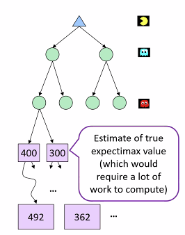
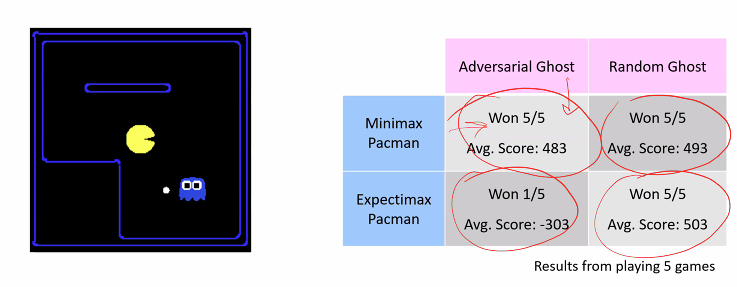

# Lecture #15 Notes - Expectimax pruning
- Author: Evan Brooks
- Date: Monday, November 2nd, 2026

## Word association exercise

### session 1
synchronous - process that must proceed stepwise 

perseverance - character trait defined by resilience and commitment to completing a task, even in the face of issues

related words: consistency

### session 2

Room 2 notes:

perseverance - character trait defined by resilience and commitment to completing a task, even in the face of issues

related words: consistency

structure - any built system that holds and supports loads, such as buildings, bridges, towers, and walls. Basically any frame that holds a load.

related words: organization, rules, form

## Expectimax pruning
- Generally, cannot be pruned in the same way as minimax, because we cannot guarantee that a pruned node will not be the best option for the maximizing player
- Unless you have specific knowledge about the bounds of outcomes, you cannot prune expectimax trees in the same way as minimax trees
  - If you know the bounds of the outcomes, you can prune expectimax trees in a similar way to minimax trees by computing the "best case" and "worst case" outcomes of the chance nodes, and using those to determine if a subtree can be pruned

## Depth-limited expectimax

## What probabilities to use?
- In expectimax search, we have a probabilistic model of how the opponent (or environment) will behave in any state
  - Model could be a simple uniform distribution over all legal moves
  - Model could be sophisticated and require a great deal of computation
  - We have a chance node for any outcome out of our control: opponent or environment
  - The model might say that adversarial actions are likely
- For now, assume each chance node magically comes along with probabilities that specify the distribution over its outcomes
- Modelling assumptions matter!
  - Recall difference in decision making within Prisoner's dilemma when we modeled different levels of selfishness
- The dangers of optimism and pessimism
  - Dangerous optimism: assuming chance when the world is adversarial
  - Dangerous pessimism: assume adversary when the world is random

## Assumptions vs. Reality

