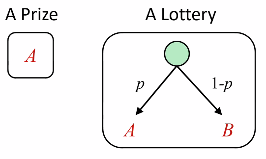
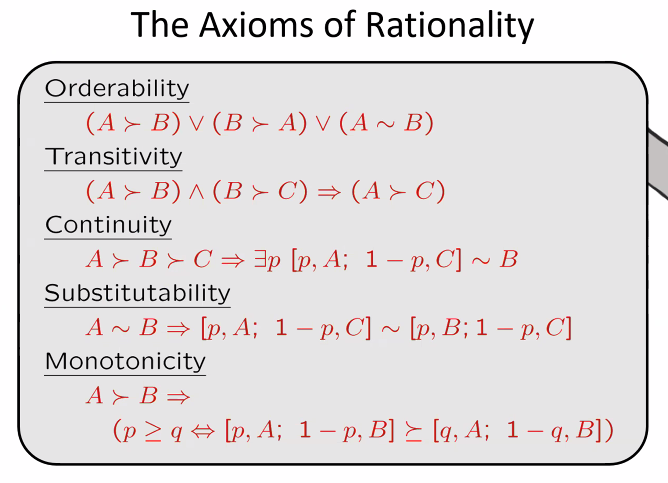
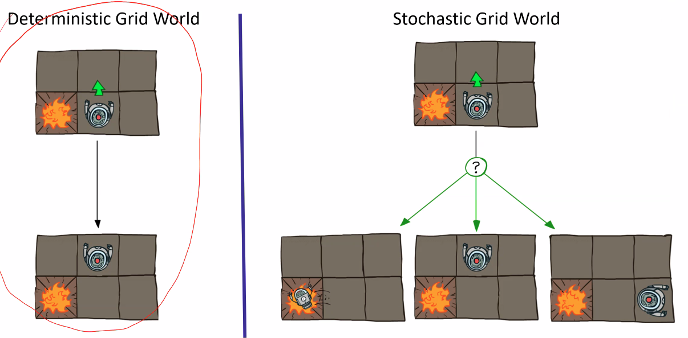
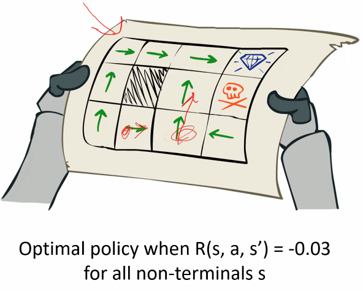
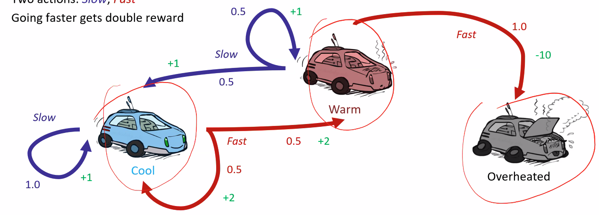
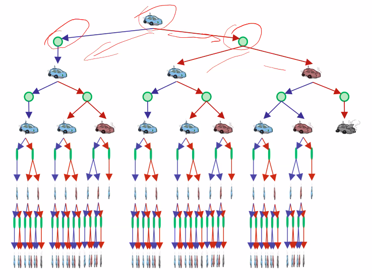
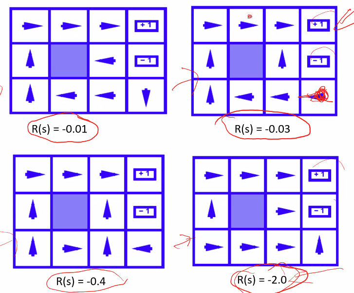

# Lecture #16 Notes
- Date: Wednesday, November 4th, 2026

## More on utilities and preferences
- Preferences lead to maximum expected utility
- Principel of maximum expected utility: a rtional agent should choose an action that optimizes the expected utility across all possible actions from a given state, given its knowledge

- Questions:
  - Where do utilities come from?
  - How do we know such utities exist?
  - How do we know that averaging even makes sense (why not maximize the weight sum of the cubes of the possible utility values or minimize the worst possible loss, for example)?
  - What if our behavior (preferences) cannot be captured by a single utility function? (e.g. we have multiple objectives that are not easily combined into a single objective)

- To answer these questions:
  - Notion of preferences understaood in a particular way is helpful

## Utitlies
- Utitlies are functions from outcomes (states of the world) to real numbers that describe an agent's preferences
- Where do utilties come from?
  - In a game, may be simple (+1/-1) for win/loss
  - Utilities summarize the agent's goals
  - Theorem: any "rational" preferences can be summarized as a utility function

- We hard-wire utitlies and let behaviors emerge
  - Why don't we prescribe behaviors directly?
    - Notes from small group discussion:
      - Less flexible; example from Pacman -- no matter how good you are at writing code, you won't cover everything
      - New situations and solutions -- example: AI that learned to play hide and seek by breaking the physics engine of the game itself
      - Time consuming - questions become intractable quickly
      - No adaptability when you hard code behaviors

## Preferences
- A agent must have preferences among:
  - Prizes/states/lotteries: $A$, $B$, et.c
  - Lotteries: situations with uncertain prizes. $L = [p, A; (1-p), B]$
  - Lotteries can be of more complex forms having 1 to $n$ possible prizes associated witht their probability; these prizes can be states or _lotteries themselves!_
- Notation:
  - Preference: $A \prec B$
  - Indifference: $A \sim B$
  - Weak preference: $A \succcurlyeq B$

## Rational Preferences
- We want some constraints on preferences before we can call them rational, such as:

Axiom of Transitivity: $(A \prec B) \land (B \prec C)\implies(A\prec C)$

- For example: an agent with _intransitive preferences_ can be induced to give away all its money
  - If $B \prec C$, then an agent with C would pay 1 cent to get B
  - If $A \prec B$, then an agent with B would pay 1 cent to get A
  - If $C \prec A$, then an agent with A would pay 1 cent to get C

## The axioms of rationality

Human readable descriptions for a couple:
- Orderability: any two lotteries must be able to be ranked
- Substitutability: if you are indifferent between A and B, and you have two lotteries, one of which refers to A and the other refers to B, and they are otherwise identical, then you should be indifferent between these lotteries

Theorem: Rational preferences imply behavior describable as maximization of expected utility.

## MEU Principle
- Given any preferences satisfying these constraints, there _exists_ a real-valued function $U$ such that

$U(A) \geq U(B) \Leftrightarrow A \succcurlyeq B$

$U([p_1,S_1; p_2,S_2; \dots p_n,S_n]) = $\Sum $

## Sequential Decision Problems
- In earlier lectures, we looked at a single agent making decisions with one-shot/episodic decisions settings
- Now we focus on sequential decision problems
  - The agent's utility will depend on the sequence of decisions
  - Outcomes are not deterministic given actions

## Lecture outline
- Start with a sample grid world
- Continue into definiing Markov Decision processes as key technical tool

## Example: Grid world
- A maze like problem where agent lives in the grid and the walls block the agents path
- Noisy movement: actions do not always go as planned
  - 80% of the time, the action North takes the agent North (if there is no wall there)
  - 10%, North takes the agent West, 10% East
  - If there is a wall in that direciton, agent stays put
- Agent receives rewards each time step
  - Small living rewards each step (can be negative)
  - Big rewards come at the end (good or bad)
- Goal: maximize sum of rewards

## Markov Decision Process
- A MDP is defined by
  - A set of states $s \in S$
  - A set of actions $a \in A$
  - A transition function $T(s, a, s')$
    - Probability $a$ from $s$ leads to $s'$
    - Also called the model or the dynamics
  - A reward function $R(s, a, s')$
    - Sometimes just $R(s)$ or $R(s')$
  - A start state
  - _May have_ a terminal state or more than one

- MDPs specify non-deterministic search problems
  - What does a solution look like for these problems?

## Policies
- In deterministic single-agent search problems, we wanted an optimal plan, or sequence of actions, from a start to the goal
- Within MDP settings no fixed sequence of actions solve the problem, hence...
- For MDPs, we want an (optimal)

policy $\pi^\star : S \rightarrow A$

  - A policy $\pi$ gives an action for each state
  - An optimal policy is one that maximizes _expected utility_ if followed
  - An explicit policy defines a reflex agent

## MDP search trees
- Each MDP state projects an expectimax-like search tree
- Expectimax-like can be used to compute the action for a single state (for entire policy we would need expecitmax-like run for each state)

## One more example: Racig
- A robot car wants to travel far and quickly
- Three states: cool, warm, overheated
- Two actions: slow, fast
- Going faster gets double reward

## Racing search tree

- We would be doing WAY too much work with expectimax-like search!
- Problem: States are repeated a lot!
  - Idea: only compute needed quantities ONCE
- Problem: Tree goes on forever
  - Idea: do a depth-limited computation, but with increasing depths
- A new algorithm will emerge that will solve these issues

## Optimal policies: balance of risk and rewards wrt $R(s)$
- The performance of an agent is measured by the sum of rewards for the visited states.
- This choice of the performance measure is not arbitrary, yet it is also not the only possible one.
- More on that...

