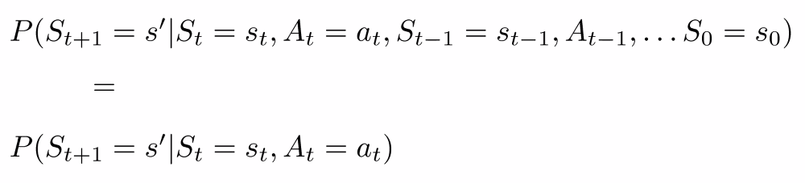
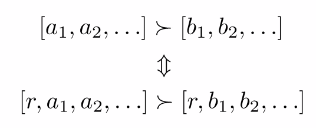
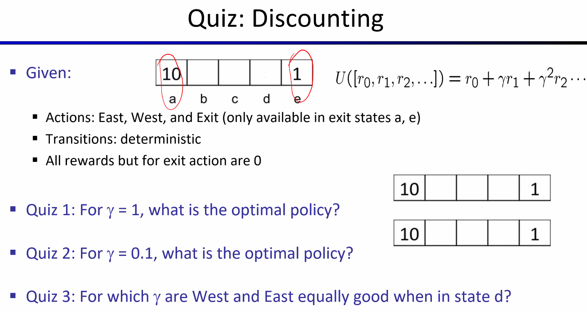
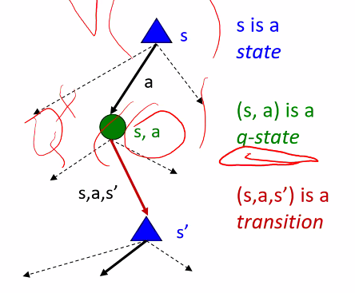

# Lecture #17 Notes
- Date: Monday, November 9th, 2026

## Optimal Policies: balance risk and reward w.r.t. $R(s)$
- The performance of an agent is measured by a sum of rewards for the visited states
- This choice of the performance measure is not arbitrary, yet it is also not the only possible one
- More on that...

## What is Markov about MDPs?
- Markov generally means that given the present state, the future and past are independent
- For Markov decision processes, "Markov" means action outcomes depend ONLY on the current state

- This is just like search, where the successor function could only depend on the current state (not the history)

## Utilities of sequences
- What preferences should an agent have over reward sequences/sequence of states/environment history?
- More or less? [1,2,2] or [2,3,4]
- Now or later? [0,1,1] or [1,0,0]
- Multiattribute utility theory has answers...

## Discounting
- It's reasonable to maximize the sum of rewards
- It's also reasonable to prefer rewards now to rewards later
- One solution: values of rewards decay exponentially
- Example:
  - Worth now: $1$
  - Worth next step: $\gamma$
  - Worth following step $\gamma^2$

- How to discount?
  - Each time we descend a level/make a step within a sequence, we multiply in the discount once
- Why discount?
  - Sooner rewards probably do have higher utility than later rewards
  - Also helps our algorithms converge
- Example: discount of 0.5, $\gamma = 0.5$
  - $U([1,2,3]) = 1*1 + 0.5*2 + 0.25*3 = 2.75$ 
  - $U([3,2,1]) = 1*3 + 0.5*2 + 0.25*1 = 4.25$

## Stationary preferences ... lead to specific performance measures
- Theorem: if we assume stationary preferences:

- Then there are only two ways to define utilities
  - Additive utility: $U([r_0, r_1, r_2,\dots]) = r_0 + r_1 + r_2 + \dots$
  - Discounted utility: $U([r_0, r_1, r_2,\dots]) = r_0 + \gamma*r_1 + \gamma^2*r_2 + \dots$

## Quiz: discounting

- For $\gamma = 1$, optimal policy: always go left
- For $\gamma = 0.1$, optimal policy: $\{b,c\} = \leftarrow, \{d\}=\rightarrow$
- For which $\gamma$ are West and East equally good when in state $d$?
  - Going East from $d$: move to $e$ (reward 0), then exit with reward 1 on the next step, so utility $= 1*\gamma$
  - Going West from $d$: move to $c$, $b$, $a$ (rewards 0), then exit with reward 10 on the 4th step, so utility $= 10*\gamma^3$
  - Set them equal: $\gamma = 10\gamma^3$
  - Divide both sides by $\gamma$ (valid since $\gamma > 0$): $1 = 10\gamma^2$
  - Divide both sides by 10: $\gamma^2 = \frac{1}{10}$
  - Take the positive square root (since $\gamma > 0$): $\gamma = \frac{1}{\sqrt{10}} \approx 0.316$

## Infinite utilities?!
- Problem: What if the game lasts forever (slow, fast, slow, fast, slow, fast,... within racing)?

- Do we get infinite rewards? How do we compare infinities?
- Three solutions:
  - finite horizons (similar to depth-limited search)
    - Terminate episodes after a fixed T steps (e.g. life)
    - Such policies are called nonstationary ($\pi$ depends on time left)
  - Discounting (solution we focus on): use $0 < \gamma < 1$
    - $U([r_0,\dots,r_{\infty}]) = \sum_{t=0}^{\infty}\gamma^t*r_t \leq \frac{R_{max}}{(1 - \gamma)}$
  - Absorbing state: guarantee that for every policy, a terminal state will eventually be reached (like "overheated" for racing)

## Solving MDPs

### Recap: defining MDPs
- Markov decision processes have...
  - a set of states $S$
  - Start state $s_0$
  - Set of actions $A$
  - Transition function $T(s,a,s')$ (the probability of landing in $s'$ after taking $a$ in $s$)
  - Reward function $R(s,a,s')$
  - Discount $\gamma$

## Optimal quantities
  - The value (utility) of a state $s$:
    - $V^*(s)$ = expected utility starting in $s$ and acting optimally
  - The value (utility) of a q-state $(s,a)$:
    - $Q^*(s,a)$ = expected utility starting out having taken action $a$ from state $s$ and _thereafter_ acting optimally
  - The optimal policy:
    - $\pi^*(s)$ = the optimal action from state $s$ (the complete policy gives one such action for every state)

