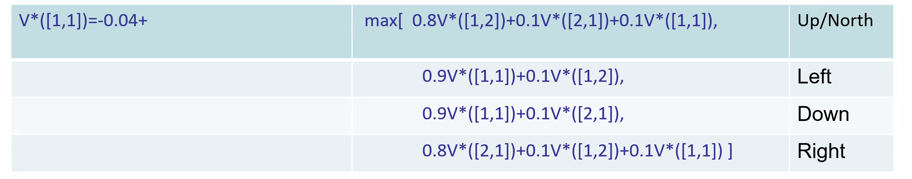
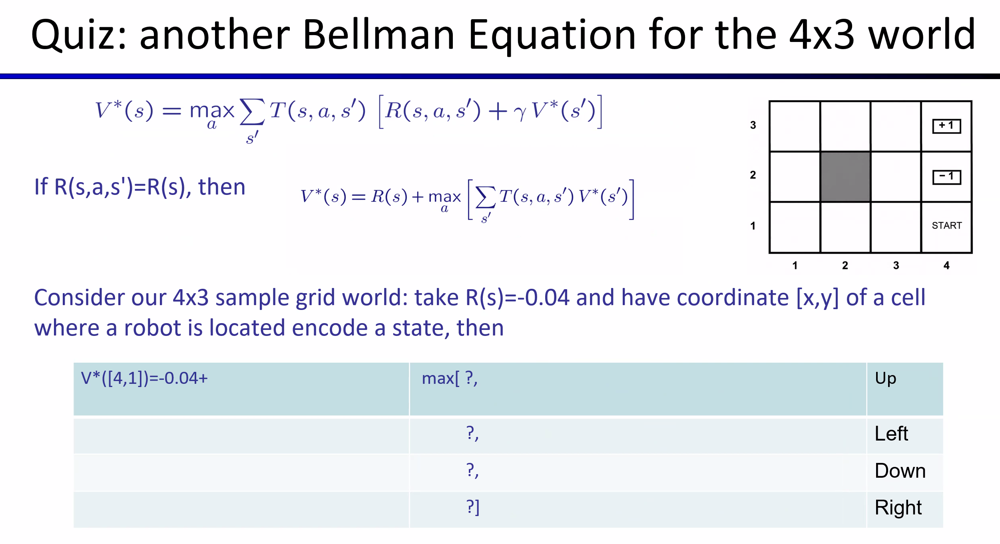
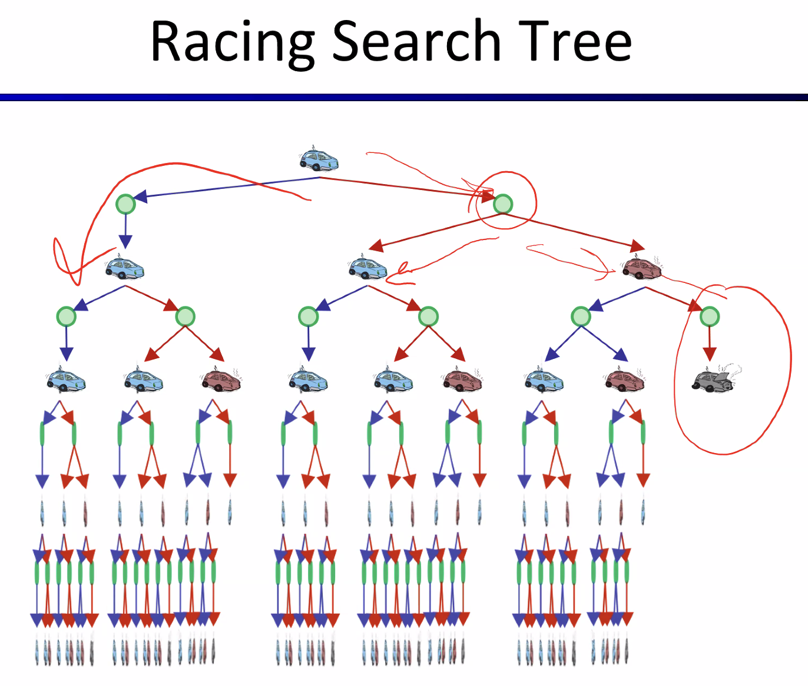
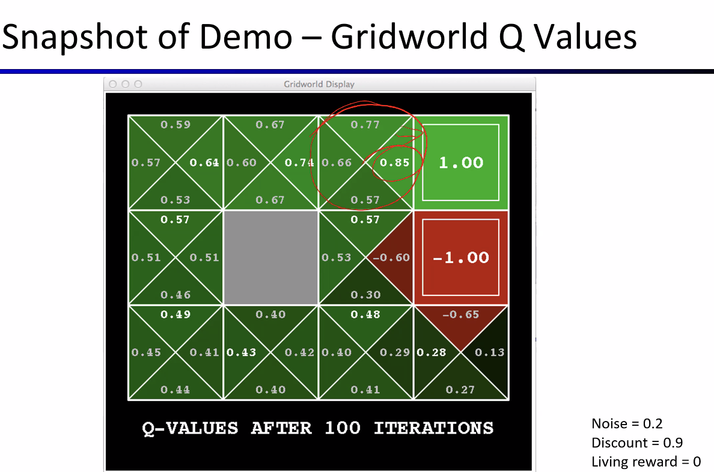

# Lecture #18 Notes
- Date: Wednesday, November 11th, 2026

## Exam: Next Wednesday, Nov 18th, 2026
- Covers lectures 1-18 (focus on multi-agent problems and MDPs)

## Optimal quantities
- $V^*(s)$: The value (utility) of a state is the expected utility of the best action from that state
- $Q^*(s, a)$: The expected utility, having taken action $a$ from state $s$ and then acting optimally thereafter
- $\pi^*(s)$: The optimal action from state $s$ (the complete policy gives one such action for every state)

## Values of states
- Fundamental operation: compute the value/utility of a state
  - Expected utility under optimal action
  - Average sum of (discounted) rewards
- Recursive definition of value:

$$
V^*(s) = \max_{a \in A(s)} Q^*(s, a)
$$

$$
Q^*(s, a) = \sum_{s' \in S} T(s, a, s') [R(s, a, s') + \gamma V^*(s')]
$$

$$
V^*(s) = \max_{a \in A(s)} \sum_{s' \in S} T(s, a, s') [R(s, a, s') + \gamma V^*(s')]
$$

Bellman Equation (1957)

## Recall: our sample grid world
- Maze like problem 
  - agent lives in a grid
  - walls block the agent's path
- Noisy movement: actions do not always go as planned
  - 80% of the time, action North (and likewise for any other direction) if there is no wall there
  - 10% of the time, North takes the agent West, 10% east
  - If there is a wall in the direction the agent would have been taken, the agent stays put
- The agent receives living rewards each step

## One of the Bellman equations for the 4x3 world
- Consider our 4x3 sample grid world, take $R(s) = -0.04$ and let the coordinate $[x,y]$ of the cell where the robot is located encode a state, then:

Up/North term: $0.8*V^*([1,2]) + 0.1*V^*([2,1]) + 0.1*V^*([1,1])$

Left term: $0.9*V^*([1,1]) + 0.1*V^*([1,2])$

Down term: $0.9*V^*([1,1]) + 0.1*V^*([2,1])$

Right term: $0.8*V^*([2,1]) + 0.1*V^*([1,2]) + 0.1*V^*([1,1])$

Full equation: $V^*([1,1]) = -0.04 + \max[ \text{north}, \text{left}, \text{right}, \text{down} ]$

## Quiz: Bellman starting at [4,1]

- Group 2: Move Left term: $0.8*V^*([3,1]) + 0.1*V^*([4,2]) + 0.1*V^*([4,1])$
- Simplifies to: $0.8*V^*([3,1]) + 0.1*-1 + 0.1*V^*([4,1])$

## Iterative approach to Bellman equations
- For $n$ states, there are $n$ Bellman equations
- The $n$ equations contain $n$ unknowns
- We would like to solve these simultaneously to find values/utilities of the states
- One problem: equations are nonlinear (remember, MAX)
- A solution: an iterative approach/value iteration algorithm

## Value iteration algorithm in a nutshell
- Start with 0s as initial values for the utilities
- Calculate the right hand side of the equation
- Plug the value into the left hand side
- Repeat until equilibrium/fixed-point/or a specific time-limited value is reached

Let us revisit a running example and place some intuitions...

## Racing search tree

- Time limited values
  - Define $V_k(s)$ to be the optimal value of $s$ if the game ends in $k$ more time steps
    - Equivalently, it's what a depth-$k$ expectimax would give from $s$
  - Note how if the game ends in 0 steps, $V_0(s)=0$ (intuition: no time steps left means an expected reward sum is zero)

- With symbols:
  - Start with $V_0(s) = 0$ (no time steps left means an expected reward sum of zero)
- Given vector of $k$-time limited values $V_k(s)$, do one ply of expectimax from each state:

$V_{k+1}(s) \leftarrow \max_a \sum_{s'}{T(s,a,s')[R(s,a,s') + \gamma V_k(s')]}$

- Repeat until convergence (the change is within provided error margin)
- Complexity of each iteration: $O(S^2*A)$
- Theorem: Will converge to unique optimal values given discounting
  - Basic idea: approximations get refined towards optimal values
  - Policy may converge long before values do

## Example: value iteration
- $V_0 = 0$ for states cool, warm, and overheated
- For $V_1$...
  - $V_1(cool)$ = max of outcomes of two actions (fast & slow)
  - slow is deterministic: value = $1 * (+1 + 1 * V_0(cool)) = 1 * (1 + 1*0) = 1$
  - fast is not deterministic: value = $0.5(+2 + 1 * V_0(cool)) + 0.5(+2 + 1 * V_0(warm)) = 2$
  - $V_1(cool) = \max[1,2] = 2$

  - $V_1(warm)$ = max of outcomes of two actions (fast and slow)
  - slow is 50/50 landing at cool and warm
    - 0.5(1 + 0) + 0.5(1 + 0) = 1
  - fast is deterministic, lands at overheated
    - 1(-10 + 0) = -10
  - $V_1(warm) = \max(1, -10) = 1$

## Convergence*

- How do we know the $V_k$ vectors are going to converge?
- Case 1: If the tree has maximum depth $M$, then $V_M$ holds the actual untruncated values
- Case 2: If the discount is less than 1
  - Sketch: For any state $V_k$ and $V_{k+1}$ can be viewed as depth $k+1$ expectimax results on nearly identical search trees
  - The difference is that on the bottom layer, $V_{k+1}$ has actual rewards while $V_k$ has zeros
  - That last layer is at best all $R_{MAX}$
  - It is at worst $R_{MIN}$
  - But everything is discounted by $\gamma^k$ that far out 
  - So $V_k$ and $V_{k+1}$ are at most $\gamma^k*\max|R|$ different
  - So as $k$ increases, the value will converge

