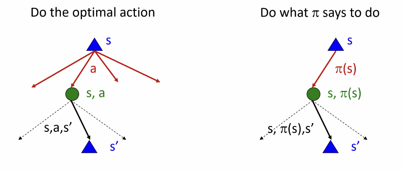
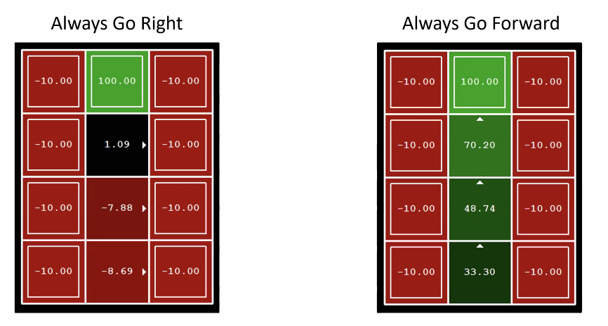

# Lecture #19 Notes
- Date: Monday, November 16th, 2026

## Exam: Wednesday, Nov 18th, 2026
- Covers lectures 1-19 (focus on multi-agent problems and MDPs)

## Policy methods: attempt to address value iteration problems
In particular, trying to address some of the issues we saw with value iteration algorithm.

With value iteration, the policy might converge long before the values do. Like to see if there are alternative methods that converge the policy faster.

## Policy iteration
- Alternative approach for computing (estimates for) optimal values:
  - Policy iteration ideas:
    - Step 1: policy evaluation: calculate utilities for some _fixed policy_ (not optimal utilities)
    - Step 2: policy improvement: update policy using one-step look-ahead with resulting converged (but not _optimal!_) utilities as future values
    - Repeat until policy converges
  - This is _policy iteration_
    - It's still optimal!
    - Can converge (much) faster under some conditions

Let's unfold what "policy evaluation" and "policy improvement" are, then revisit policy iteration...

## Fixed policies

- Expectimax trees max over all actions to compute the optimal values
- If we fixed some policy $\pi(s)$ then the tree would be simpler - only one action per state
  - ... though the tree's value would depend on which policy we fixed

## Utilities for a fixed policy
- basic operation: compute the utility of a state $s$ under a fixed (generally non-optimal) policy
- define the utility of a state $s$ under a fixed policy $\pi$:
  $V^\pi(s) = $ expected total discounted rewards starting in $s$ and following $\pi$

- Recursive relation (one-step look-ahead/Bellman equation)

$$V^\pi(s) = \sum_{s'} T(s, \pi(s), s') \left[ R(s, \pi(s), s') + \gamma V^\pi(s') \right]$$

- For n states, there are n linear equations defining these values

## Policy evaluation

- Idea 1: Turn recursive Bellman equations into updates (like value iteration):

$$V_0^\pi(s) = 0$$

$$V_{k+1}^\pi(s) \leftarrow \ldots$$

- Since it is a series of S linear equations with S variables, we can solve with Matlab or standard linear algebra methods (efficiency $O(S^3)$); exact methods
- Or

## Example policy evaluation:
- Always go right vs Always go forward

## Policy extraction

### Computing actions from values
- Let's imagine that we have the optimal values $V^{*}(s)$
- How should we act?
  - It's not obvious!
- We need to do a mini expectimax (one step)

$$\pi^*(s) = \arg\max_a \sum_{s'} T(s,a,s') \left[ R(s,a,s') + \gamma V^*(s') \right]$$

- This is called _policy extraction_ since it gets the policy (aka action $a$ at state $s$ implied by the values)

## Computing actions from Q-values
- Let's imagine we have the optimal q-values:

- How should we act?
  - completely trivial to decide!

$$\pi^*(s) = \arg\max_a Q^*(s,a)$$

- Important lessons: actions are easier to select from q-values than values!

## Policy iteration with details
- Evaluation: for fixed current policy $\pi$, find values with _policy evaluation_:
  - Either solve linear equations (matlab) or,
  - Iterate until values converge

- Improvement: For fixed values, get a better policy using policy extraction:
  - Start with an initial policy $\pi_0$ (random)
  - One-step look-ahead...
  - Until converges (no changes are made from iteration $i$ to $i+1$)
