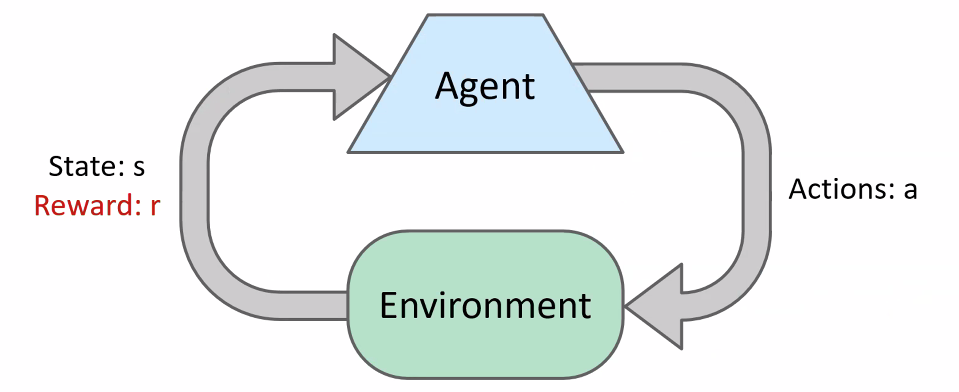
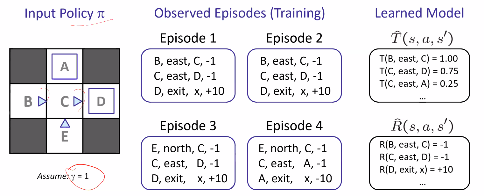
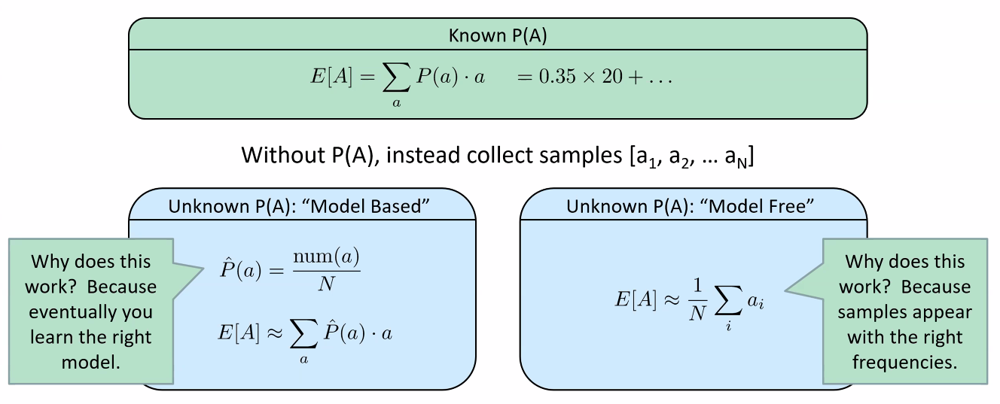
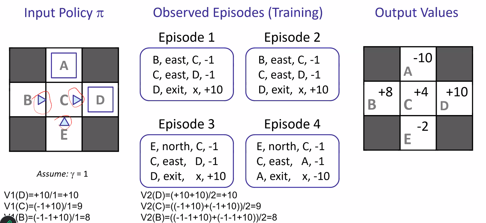

# Lecture #20 Notes
- Date: Monday, November 23rd, 2026

## Artificial intelligence: Reinforcement Learning

- Basic idea:
  - Receive feedback in the form of rewards
  - Agent's utility is defined by the rewards function
  - Must (learn to) act so as to maximize expected rewards
  - ALL learning is based on observed samples of outcomes!

- Previously, our reward and success functions were defined upfront. Now we are switching gears to where the model can _learn_ via computational methods to refine the model.
- Reinforcement learning is a type of machine learning, and very popular within the robotics field

## Example: learning to walk

## Technical details:
- Still assume a Markov decision process (MDP):
  - A set of states $s \in S$
  - A set of actions (per state) $a \in A$
  - A model $T(s,a,s')$
  - A reward function $R(s,a,s')$

- Still looking for a policy: $\pi(s)$
- New twist: don't _know_ $T$ or $R$
  - i.e. we don't know which states are good or what the actions do
  - Must actually try actions and states out to learn

- Goal: translating our actions and their results to populate the transition and rewards functions as we try things out

## Offline (MDPs) vs Online (RL)
- Offline - know the effect of actions on rewards, makes plan before acting
- Online - do not (completely) know the effect of actions on rewards, compiles consequences of attempted actions into a model and use that to inform future behavior

## Model-based learning
- Learn an approximate model based on experiences
- Solve for values as if the learned model were correct

1. Learn empirical model \
  a. count outcomes $s'$ for each $s, a$ \
  b. normalize to give estimate for $\widehat{T}(s, a, s')$ \
  c. discover each $\widehat{R}(s,a,s')$ when we experience $s,a,s'$
2. Solve the learned MDP \
  a. For example, use value iteration as before

## Example: model-based learning in grid world

## Example: expected age
- Goal: compute the expected age of cs188 students

## Alternative: Passive reinforcement learning
- Simplified task: policy evaluation
  - Input: a fixed policy $\pi(s)$
  - You don't know the transitions $T(s,a,s')$
  - You don't know the rewards $R(s,a,s')$
  - Goal: _learn the state values_
- In this case:
  - The learner is "along for the ride"
  - No choice about what actions to take
  - Just execute the policy and learn from experience
  - This is NOT offline planning! You actually take actions in the world.

## Direct evaluation
- Goal: compute values for each state under $\pi$
- Idea: average together observed sample values
  - Act according to $\pi$
  - Every time you visit a state, write down the sum of discounted rewards
  - Average those samples

## Example: direct evaluation

#### Group 1: $V_3$

- $V_3(E) = (-1 + -1 + 10) / 1 = 8$, 1 observation
- $V_3(C) = 9$, 3 observations
- $V_3(D) = 10$, 3 observations

#### Group 2: $V_4$

## Problems with direct evaluation
- What's good about direct evaluation?
  - It's easy to understand
  - It doesn't require any knowledge of T, R
  - It eventually computes the correct average values, using just sample transitions

- What's bad about it?
  - It wastes information about state connections
  - Each state must be learned separately
  - So, it takes a long time to learn
  - Because we are basing our estimates on states independently, disregarding the relationship between states
